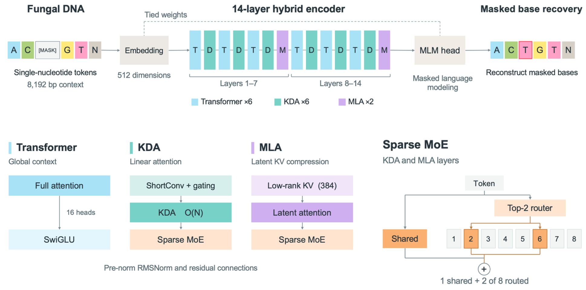
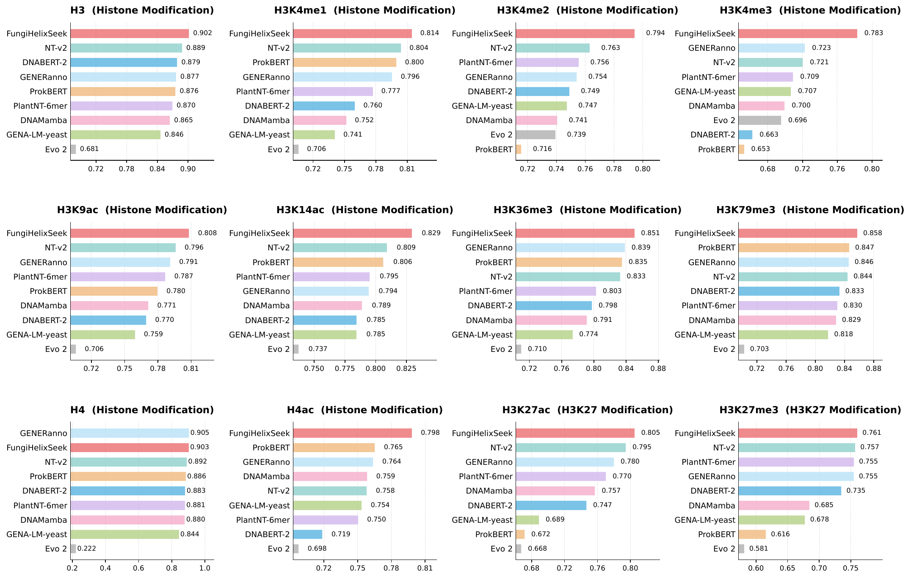

<div align="center">


# FungiHelixSeek

**A Hybrid Linear Attention-Transformer Mixture-of-Experts (MoE) DNA foundation model for Fungi**

*Single-nucleotide resolution · Bidirectional Masked Language Modeling (MLM) · 8,192 bp context · Trained on fungal genomes*

[](https://www.python.org/)
[](https://pytorch.org/)
[](https://huggingface.co/docs/transformers/)
[](LICENSE)
[](https://huggingface.co/collections/zhangtaolab/fungihelixseek)
[](https://www.modelscope.cn/collections/zhangtaolab/FungiHelixSeek)

</div>

> [!NOTE]
> **FungiHelixSeek** is a fungal DNA foundation model pretrained with masked language modeling at single-nucleotide resolution, together with **15 task-specific models** covering taxonomic classification, gene structure prediction, and 12 epigenomic tasks.

## Table of Contents

- [FungiHelixSeek](#fungihelixseek)
  - [Table of Contents](#table-of-contents)
  - [Overview](#overview)
    - [Model Details](#model-details)
  - [Benchmark](#benchmark)
  - [Model Zoo](#model-zoo)
    - [Base Model](#base-model)
    - [Task-Specific Models](#task-specific-models)
    - [Download](#download)
  - [Installation](#installation)
  - [Quick Start](#quick-start)
    - [Python API](#python-api)
    - [Mask Recovery Inference](#mask-recovery-inference)
    - [Fine-tuning (Sequence Classification)](#fine-tuning-sequence-classification)
    - [Prediction](#prediction)
    - [DNALLM Quick Start](#dnallm-quick-start)
  - [Downstream Pipelines](#downstream-pipelines)
  - [Fine-tune Datasets](#fine-tune-datasets)
    - [Download](#download-1)
  - [Scripts](#scripts)
    - [HuggingFace Transformers (`scripts/huggingface/`)](#huggingface-transformers-scriptshuggingface)
    - [DNALLM Integration (`scripts/dnallm/`)](#dnallm-integration-scriptsdnallm)
    - [Downstream Pipelines](#downstream-pipelines-1)
  - [Repository Structure](#repository-structure)
  - [Citation](#citation)
  - [Acknowledgments](#acknowledgments)
  - [License](#license)
  - [Contact](#contact)

---

## Overview

**FungiHelixSeek** is pretrained on fungal genomes with masked language modeling at single-nucleotide resolution. It is built on the **HelixSeek** architecture — a hybrid stack that interleaves three complementary layer types for efficient long-context bidirectional DNA modeling:

<p align="center">
  
</p>

| Component                        | Role                                                                                       | Inspiration                                                                                                 |
| -------------------------------- | ------------------------------------------------------------------------------------------ | ----------------------------------------------------------------------------------------------------------- |
| **Transformer layers**     | Full attention for precise positional reasoning                                            | BERT / RoBERTa                                                                                              |
| **HelixSeek-Delta layers** | Delta Attention (KDA): linear attention with gated delta rule for O(n) long-range modeling | [Kimi-Linear](https://github.com/MoonshotAI/Kimi-Linear) / [Gated DeltaNet](https://arxiv.org/abs/2412.06464) |
| **HelixSeek-MLA layers**   | Multi-head Latent Attention (MLA) for KV-cache compression                                 | [Kimi-Linear](https://github.com/MoonshotAI/Kimi-Linear)                                                     |

The FFN uses a sparse **Mixture-of-Experts (MoE)** with 8 routed experts (top-2 routing) plus 1 shared expert, achieving high capacity at constant inference cost.

### Model Details

| Property                    | Value                                                           |
| --------------------------- | --------------------------------------------------------------- |
| Total parameters            | 263M                                                            |
| Active parameters per token | ~112M (MoE routing: top-2 of 8 + 1 shared)                      |
| Hidden size                 | 512                                                             |
| Layers                      | 14 (hybrid: 6 Transformer + 6 KDA + 2 MLA)                      |
| Attention heads             | 16                                                              |
| Experts                     | 8 routed (top-2) + 1 shared                                     |
| Max context length          | 8,192 bp                                                        |
| Vocabulary                  | 11 tokens (single-nucleotide: A, T, C, G, N + specials)         |
| Tokenizer                   | SingleBase (1 nucleotide = 1 token)                             |
| Architecture                | HelixSeek (Transformer + KDA + MLA + MoE,`trust_remote_code`) |

---

## Benchmark

FungiHelixSeek vs **8 leading DNA foundation models** on **12 fungal epigenomic tasks** (10 GUE histone-modification benchmarks + 2 custom H3K27 tasks; *S. cerevisiae*, 500 bp windows, binary classification; dev-set best metric):

| Rank | Model                    |              Points |          Z-score | Avg. Performance |
| :--: | :----------------------- | ------------------: | ---------------: | ---------------: |
|  1  | **FungiHelixSeek** | **107 / 108** | **+14.55** |  **0.826** |
|  2  | NT-v2                    |                  87 |            +7.32 |            0.805 |
|  3  | GENERanno                |                  82 |            +5.92 |            0.802 |
|  4  | PlantNT-6mer             |                  63 |            +2.96 |            0.790 |
|  5  | DNABERT-2                |                  49 |           −1.85 |            0.777 |
|  6  | DNAMamba                 |                  45 |           −0.90 |            0.777 |
|  7  | ProkBERT                 |                  59 |           −1.81 |            0.771 |
|  8  | GENA-LM-yeast            |                  33 |           −3.92 |            0.762 |
|  9  | Evo 2                    |                  15 |          −22.27 |            0.654 |

> **FungiHelixSeek ranks first on 11 of 12 tasks** (only H4 trails GENERanno by 0.18 pp) and leads the runner-up by **2.1 percentage points** on average — all four scoring protocols (rank points / Z-score / Min-Max / mean) agree. Fungal-corpus pretraining consistently outperforms both general-purpose and yeast-specific models.



---

## Model Zoo

FungiHelixSeek ships with **1 pretrained base model** and **14 task-specific fine-tuned models** covering fungal taxonomy, genome annotation, and epigenomics. All models load with `trust_remote_code=True`.

### Base Model

| Model Name               | Params | Pretraining | Context  | Architecture                              | Model Download                                                                                                                   |
| ------------------------ | ------ | ----------- | -------- | ----------------------------------------- | -------------------------------------------------------------------------------------------------------------------------------- |
| **FungiHelixSeek** | 263M   | MLM         | 8,192 bp | HelixSeek (Transformer + KDA + MLA + MoE) | [🤗 HF](https://huggingface.co/zhangtaolab/FungiHelixSeek) · [🧩 MS](https://www.modelscope.cn/models/zhangtaolab/FungiHelixSeek) |

### Task-Specific Models

**Taxonomy (1)** — 6-level ITS barcode classification:

| Model Name                  | Task                                       | Classes    | Key Result                                    | Model Download                                                                                                                                     |
| --------------------------- | ------------------------------------------ | ---------- | --------------------------------------------- | -------------------------------------------------------------------------------------------------------------------------------------------------- |
| `FungiHelixSeek-Taxonomy` | ITS barcode → phylum … species (6 heads) | 18–14,742 | Species acc **70.8%** (Filamentous test) | [🤗 HF](https://huggingface.co/zhangtaolab/FungiHelixSeek-Taxonomy) · [🧩 MS](https://www.modelscope.cn/models/zhangtaolab/FungiHelixSeek-Taxonomy) |

**Genome Annotation (1)** — gene structure prediction:

| Model Name              | Task                                             | Labels     | Key Result (11-species mean)                               | Model Download                                                                                                                             |
| ----------------------- | ------------------------------------------------ | ---------- | ---------------------------------------------------------- | ------------------------------------------------------------------------------------------------------------------------------------------ |
| `FungiHelixSeek-Anno` | Per-nucleotide gene features → GFF3 (BILOU+HMM) | 17 (BILOU) | CDS base F1 **0.943** (8-species mean) | [🤗 HF](https://huggingface.co/zhangtaolab/FungiHelixSeek-Anno) · [🧩 MS](https://www.modelscope.cn/models/zhangtaolab/FungiHelixSeek-Anno) |

**Epigenomics (12)** — histone-mark region prediction (all binary, 500 bp):

| Model Name                 | Source  | Score | Model Name                  | Source                  | Score |
| -------------------------- | ------- | ----: | --------------------------- | ----------------------- | ----: |
| `FungiHelixSeek-H3`      | GUE EMP | 0.902 | `FungiHelixSeek-H3K36me3` | GUE EMP                 | 0.851 |
| `FungiHelixSeek-H3K4me1` | GUE EMP | 0.814 | `FungiHelixSeek-H3K79me3` | GUE EMP                 | 0.858 |
| `FungiHelixSeek-H3K4me2` | GUE EMP | 0.794 | `FungiHelixSeek-H4`       | GUE EMP                 | 0.903 |
| `FungiHelixSeek-H3K4me3` | GUE EMP | 0.783 | `FungiHelixSeek-H4ac`     | GUE EMP                 | 0.798 |
| `FungiHelixSeek-H3K9ac`  | GUE EMP | 0.808 | `FungiHelixSeek-H3K27ac`  | Custom-built (in-house) | 0.805 |
| `FungiHelixSeek-H3K14ac` | GUE EMP | 0.829 | `FungiHelixSeek-H3K27me3` | Custom-built (in-house) | 0.761 |

Each epigenomic model links to its dataset subset — see [docs/finetune_datasets.md](docs/finetune_datasets.md) for the full model–dataset mapping with download commands.

### Download

```bash
# Base model
huggingface-cli download zhangtaolab/FungiHelixSeek --local-dir ./models/FungiHelixSeek

# Task model (save under models/ or models/finetuned/)
huggingface-cli download zhangtaolab/FungiHelixSeek-Taxonomy \
    --local-dir ./models/FungiHelixSeek-Taxonomy

# All 12 epigenomic models in parallel
for m in H3 H3K4me1 H3K4me2 H3K4me3 H3K9ac H3K14ac H3K36me3 H3K79me3 H4 H4ac H3K27ac H3K27me3; do
  huggingface-cli download "zhangtaolab/FungiHelixSeek-$m" \
      --local-dir "./models/finetuned/FungiHelixSeek-$m" &
done; wait
```

**Via ModelScope** (no mirror needed):

```bash
modelscope download --model zhangtaolab/FungiHelixSeek --local_dir ./models/FungiHelixSeek
modelscope download --model zhangtaolab/FungiHelixSeek-Taxonomy --local_dir ./models/FungiHelixSeek-Taxonomy
```

> 💡 Mirror option: `export HF_ENDPOINT=https://hf-mirror.com`.

> ⚠️ Always pass `trust_remote_code=True` when loading — the HelixSeek architecture is registered via HuggingFace `auto_map`.

---

## Installation

**Requirements**: Python ≥ 3.12 · NVIDIA GPU (CUDA 12.x), Apple Silicon (MPS), or CPU

Managed with [uv](https://docs.astral.sh/uv/), using a local `.venv` environment in the repository root:

```bash
git clone https://github.com/zhangtaolab/FungiHelixSeek.git
cd FungiHelixSeek

# Install uv (if not already available)
curl -LsSf https://astral.sh/uv/install.sh | sh

# Create the .venv environment (Python 3.12)
uv venv --python 3.12 .venv
source .venv/bin/activate

# PyTorch first (choose one)
uv pip install torch --index-url https://download.pytorch.org/whl/cu128   # NVIDIA GPU (CUDA 12.x/13.x)
uv pip install torch                                                     # CPU only
uv pip install "torch>=2.12"                                             # Apple Silicon (MPS)

# Dependencies
uv pip install -r requirements.txt

# Verify
python scripts/huggingface/verify_install.py --model_path models/FungiHelixSeek
```

> ⚠️ CPU mode is for code debugging only — the 263M-parameter model is very slow on CPU.

### Apple Silicon (macOS, MPS)

```bash
uv pip install "torch>=2.12"   # 2.12.0 / 2.13.0 / 2.14.1 verified
uv pip install -r requirements.txt
python scripts/huggingface/verify_install.py --model_path models/FungiHelixSeek --device mps
```

There are no Triton wheels for macOS, so the KDA layers run a pure PyTorch
fallback — use MPS for validation, not throughput. On **torch <= 2.11** the MPS
SDPA kernel returns a query-shaped output when the value head dim is smaller
than the query head dim, which crashes the MLA layers; upgrade or patch the
downloaded checkpoint:

```bash
python scripts/huggingface/apply_mps_fix.py --model_path models/FungiHelixSeek --kda_fallback
```

See [docs/installation.md](docs/installation.md) for details.

📖 **Full installation guide**: [docs/installation.md](docs/installation.md)

---

## Quick Start

### Python API

```python
from transformers import AutoModelForMaskedLM, AutoTokenizer
import torch

# Load from local path or HuggingFace Hub
model_path = "models/FungiHelixSeek"  # or "zhangtaolab/FungiHelixSeek"
tokenizer = AutoTokenizer.from_pretrained(model_path, trust_remote_code=True)
model = AutoModelForMaskedLM.from_pretrained(model_path, trust_remote_code=True)

device = torch.device("cuda" if torch.cuda.is_available() else "cpu")
model = model.to(device)

# Mask recovery: predict masked nucleotides
seq = "ATCGGCTAAGCCT<mask>GTCAGTTACCGATCG"
inputs = tokenizer(seq, return_tensors="pt")
inputs = {k: v.to(device) for k, v in inputs.items()}
with torch.no_grad():
    logits = model(**inputs).logits

mask_pos = (inputs["input_ids"][0] == tokenizer.mask_token_id).nonzero()[0]
predicted = logits[0, mask_pos].argmax(-1)
print(tokenizer.convert_ids_to_tokens(predicted))  # → ['T']
```

### Mask Recovery Inference

```bash
python scripts/huggingface/inference.py \
    --model_path models/FungiHelixSeek \
    --input_file data/test_data/inference_example.jsonl \
    --output_file tmp/mask_recovery.jsonl \
    --top_k 5
```

### Fine-tuning (Sequence Classification)

```bash
python scripts/huggingface/finetune.py \
    --pretrained_model models/FungiHelixSeek \
    --dataset_dir data/Bio_finetune_data/fungi-histone-modifications/H3K4me3 \
    --output_dir tmp/finetune_output \
    --tokens_length 512 \
    --num_train_epochs 3
```

### Prediction

```bash
python scripts/huggingface/predict.py \
    --model_path models/finetuned/FungiHelixSeek-H3K4me3 \
    --input_file data/test_data/predict_example.csv \
    --output_file tmp/predictions.csv
```

### DNALLM Quick Start

The [DNALLM](https://github.com/zhangtaolab/dnallm) package provides higher-level APIs for common DNA model operations — embeddings, scoring, mutagenesis, and interpretability:

```bash
uv pip install dnallm
```

```python
from dnallm import DNAInference

inferencer = DNAInference(
    model_path="models/FungiHelixSeek",
    trust_remote_code=True,
    device="auto",
)

emb = inferencer.get_embeddings(
    inputs=["ATCGGCTAAGCCTGTCAGTT", "GGCCCATTGCATGCAATGCAT"],
    reduce_strategy="mean",
)

scores = inferencer.scoring(
    inputs=["ATCGGCTAAGCCTGTCAGTT", "GGCCCATTGCATGCAATGCAT"],
    score_type="loss",
)
```

> 📖 See [scripts/dnallm/README.md](scripts/dnallm/README.md) for the full list of 6 DNALLM scripts.

---

## Downstream Pipelines

Two flagship downstream tasks ship with dedicated, end-to-end pipelines:

| Pipeline                                                                   | Task                                     | Model                       | Highlights                                                       |
| -------------------------------------------------------------------------- | ---------------------------------------- | --------------------------- | ---------------------------------------------------------------- |
| [scripts/species_classification/](scripts/species_classification/README.md) | 6-level ITS taxonomic classification     | `FungiHelixSeek-Taxonomy` | FASTA → taxonomy CSV; multi-head + hierarchical label smoothing |
| [scripts/gene_annotation/](scripts/gene_annotation/README.md)               | Genome → GFF3 gene structure prediction | `FungiHelixSeek-Anno`     | Sliding-window inference + phase-aware HMM Viterbi decoding      |

```bash
# Taxonomy: classify ITS barcodes
python scripts/species_classification/predict.py \
    --model_path models/FungiHelixSeek-Taxonomy \
    --input_fasta your_its.fasta \
    --output tmp/taxonomy.csv

# Annotation: annotate a fungal genome
python scripts/gene_annotation/annotate_genome.py \
    --genome-fasta your_genome.fa.gz \
    --model-path models/FungiHelixSeek-Anno \
    --out your_genome.gff3
```

> 📖 Each pipeline has a detailed README with arguments, output formats, training recipes, and benchmark tables.

---

## Fine-tune Datasets

Downstream datasets are released in the **[FungiHelixSeek](https://huggingface.co/collections/zhangtaolab/fungihelixseek)** 🤗 collection — 3 dataset repos, shipped as ready-to-use splits:

| Dataset                           | Task                           | Size    | Fine-tuned Model(s)                    |                                      HF                                      |                                   ModelScope                                   |
| --------------------------------- | ------------------------------ | ------- | -------------------------------------- | :--------------------------------------------------------------------------: | :-----------------------------------------------------------------------------: |
| `fungi-histone-modifications`   | 12 histone-mark binary tasks   | ~130 MB | `FungiHelixSeek-{H3…H3K27me3}` (12) | [🤗](https://huggingface.co/datasets/zhangtaolab/fungi-histone-modifications) | [🧩](https://www.modelscope.cn/datasets/zhangtaolab/fungi-histone-modifications) |
| `fungi-its-barcodes`            | 6-level ITS taxonomy           | ~3.6 GB | `FungiHelixSeek-Taxonomy`            |     [🤗](https://huggingface.co/datasets/zhangtaolab/fungi-its-barcodes)     |     [🧩](https://www.modelscope.cn/datasets/zhangtaolab/fungi-its-barcodes)     |
| `FungiHelixSeek-Anno` (dataset) | Gene structure (17 BILOU tags) | ~900 MB | `FungiHelixSeek-Anno`                |     [🤗](https://huggingface.co/datasets/zhangtaolab/FungiHelixSeek-Anno)     |     [🧩](https://www.modelscope.cn/datasets/zhangtaolab/FungiHelixSeek-Anno)     |

### Download

```bash
# Histone modifications (12 subsets: H3, H3K4me1, ..., H3K27ac, H3K27me3)
huggingface-cli download zhangtaolab/fungi-histone-modifications \
    --repo-type dataset \
    --local-dir data/Bio_finetune_data/fungi-histone-modifications

# ITS barcodes
huggingface-cli download zhangtaolab/fungi-its-barcodes \
    --repo-type dataset \
    --local-dir data/species_classification

# Annotation fine-tune data
huggingface-cli download zhangtaolab/FungiHelixSeek-Anno \
    --repo-type dataset \
    --local-dir data/gene_annotation_dataset
```

**Via ModelScope**:

```bash
modelscope download --dataset zhangtaolab/fungi-histone-modifications \
    --local_dir data/Bio_finetune_data/fungi-histone-modifications
modelscope download --dataset zhangtaolab/fungi-its-barcodes \
    --local_dir data/species_classification
modelscope download --dataset zhangtaolab/FungiHelixSeek-Anno \
    --local_dir data/gene_annotation_dataset
```

> 📖 Detailed dataset descriptions, splits, and the full model–dataset mapping: [docs/finetune_datasets.md](docs/finetune_datasets.md)

---

## Scripts

### HuggingFace Transformers (`scripts/huggingface/`)

| Script                                                    | Task                                |
| --------------------------------------------------------- | ----------------------------------- |
| [inference.py](scripts/huggingface/inference.py)           | MLM mask recovery                   |
| [finetune.py](scripts/huggingface/finetune.py)             | Sequence classification fine-tuning |
| [predict.py](scripts/huggingface/predict.py)               | Fine-tuned model prediction         |
| [verify_install.py](scripts/huggingface/verify_install.py) | Environment verification            |
| [apply_mps_fix.py](scripts/huggingface/apply_mps_fix.py)   | macOS/MPS checkpoint patch (SDPA + KDA fallback) |

### DNALLM Integration (`scripts/dnallm/`)

High-level wrappers using the [DNALLM](https://github.com/zhangtaolab/dnallm) package:

| Script             | Task                                           |
| ------------------ | ---------------------------------------------- |
| `finetune.py`    | Classification fine-tuning                     |
| `predict.py`     | Prediction                                     |
| `embeddings.py`  | Embedding extraction                           |
| `scoring.py`     | Sequence scoring (loss / probability / logits) |
| `mutagenesis.py` | Saturation mutagenesis scan                    |
| `interpret.py`   | Model interpretability (Captum)                |

### Downstream Pipelines

| Directory                                                                  | Task                                 | Model                       |
| -------------------------------------------------------------------------- | ------------------------------------ | --------------------------- |
| [scripts/species_classification/](scripts/species_classification/README.md) | 6-level ITS taxonomic classification | `FungiHelixSeek-Taxonomy` |
| [scripts/gene_annotation/](scripts/gene_annotation/README.md)               | Gene structure prediction → GFF3    | `FungiHelixSeek-Anno`     |

---

## Repository Structure

```
FungiHelixSeek/
├── models/                            # Model weights (download separately)
│   ├── FungiHelixSeek/                #   Base model (263M, MLM)
│   ├── FungiHelixSeek-Taxonomy/       #   ITS taxonomy model
│   ├── FungiHelixSeek-Anno/           #   Gene annotation model
│   └── finetuned/                     #   12 epigenomic models
├── data/
│   ├── Bio_finetune_data/             # 12 histone-mark datasets (download)
│   ├── species_classification/        # ITS barcode datasets (download)
│   ├── gene_annotation/               # HMM priors + test genome fixture
│   ├── gene_annotation_dataset/       # Annotation fine-tune data (download)
│   └── test_data/                     # Smoke-test fixtures
├── scripts/
│   ├── huggingface/                   # Main scripts (inference/finetune/predict)
│   ├── dnallm/                        # DNALLM package wrappers
│   ├── species_classification/        # Taxonomy pipeline
│   └── gene_annotation/               # Annotation pipeline (predict + HMM decode)
├── tests/                             # End-to-end smoke tests
├── docs/                              # Installation & dataset docs
├── picture/                           # Logo, benchmark figures
├── requirements.txt
├── pyproject.toml
└── LICENSE
```

---

## Citation

If you use FungiHelixSeek in your research, please cite:

```bibtex
@article{FungiHelixSeek2026,
  title   = {FungiHelixSeek: a kingdom-scale DNA foundation model capturing fungal sequence grammar across taxonomic, structural and regulatory scales},
  author  = {YueChao WU},
  year    = {2026},
  url     = {https://huggingface.co/zhangtaolab/FungiHelixSeek}
}
```

---

## Acknowledgments

- **[Kimi-Linear](https://github.com/MoonshotAI/Kimi-Linear)** — Delta Attention (KDA) and Multi-head Latent Attention (MLA) architecture
- **[Flash Linear Attention (FLA)](https://github.com/fla-org/flash-linear-attention)** — Efficient chunkwise kernels for KDA layers
- **[HuggingFace Transformers](https://github.com/huggingface/transformers)** — Model loading, training, and inference framework
- **[GUE](https://github.com/lingxinzhou/GUE)** — Genomic understanding evaluation benchmark (EMP histone-modification tasks)
- **[MyCoAI](https://github.com/MycoAI/MyCoAI)** / **[UNITE](https://unite.ut.ee)** — ITS taxonomy data conventions
- **[DNALLM](https://github.com/zhangtaolab/dnallm)** — High-level DNA foundation model toolkit

---

## License

- **Code**: [MIT License](LICENSE)
- **Model weights & datasets**: CC-BY-NC 4.0 (research use; contact authors for commercial licensing)

---

## Contact

- **Email**: [wuyuechao@zhangtaolab.org](mailto:wuyuechao@zhangtaolab.org)
